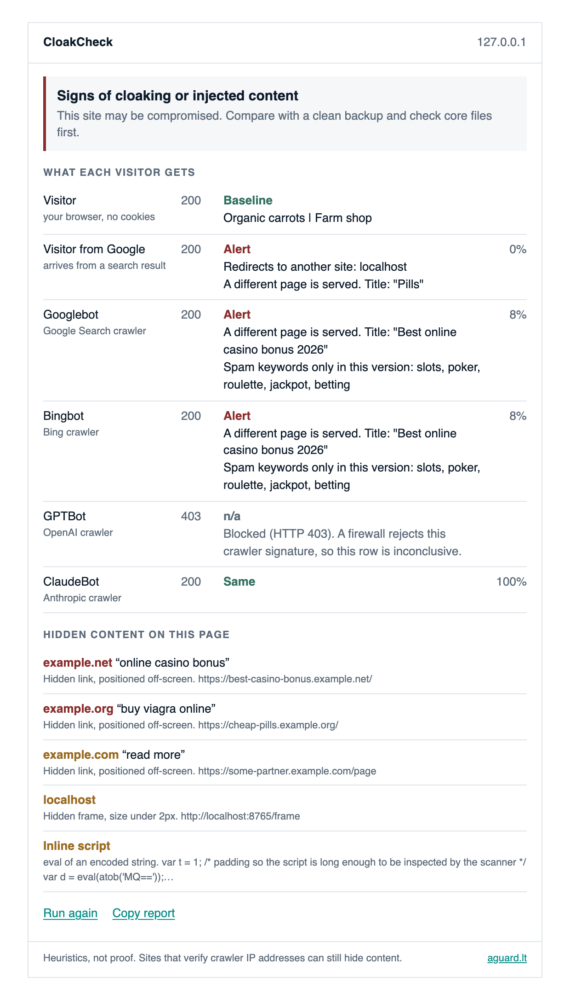
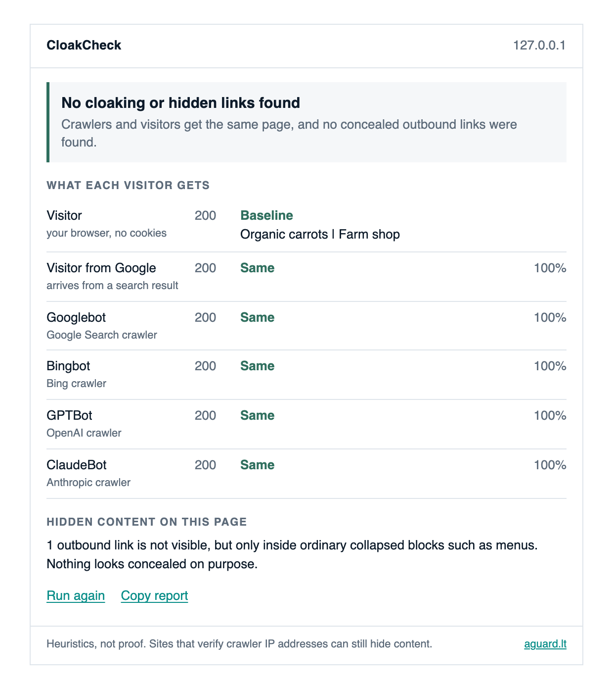

# CloakCheck

A Chrome extension that shows whether a website serves the same page to people, to search engines and to AI crawlers, and whether the page you are looking at carries hidden links.

Hacked sites often look normal to their owners. The injected casino or pharmacy pages are served only to Googlebot, or only to visitors who arrive from a search result, so the owner finds out from a traffic drop or a "this site may be hacked" label. CloakCheck makes that difference visible in one click.

| Compromised site | Clean site |
| --- | --- |
|  |  |

Both screenshots come from the automated test in `test/e2e.py`, which runs the extension against a local server that cloaks by User-Agent.

## What it checks

**1. What each visitor gets.** The current URL is requested six times, without cookies, and each response is compared with what a normal visitor receives:

| Request | Signature |
| --- | --- |
| Visitor | your browser's own User-Agent |
| Visitor from Google | your User-Agent plus a `Referer` of a Google result page |
| Googlebot | Google Search crawler User-Agent |
| Bingbot | Bing crawler User-Agent |
| GPTBot | OpenAI crawler User-Agent |
| ClaudeBot | Anthropic crawler User-Agent |

For each row it reports the HTTP status, text similarity with the visitor version, a changed title, redirects to another domain, external domains that appear only in that version, and spam vocabulary that appears only in that version. The visitor page is fetched twice first, so a page that changes on every load does not raise a false alarm.

**2. Hidden content on the page you see.** The rendered page is scanned for outbound links a visitor cannot see: `display:none`, zero opacity, text under 2px, blocks positioned off-screen, zero-size boxes, text in the background colour. Hidden frames and inline scripts that `eval` encoded strings are listed as well. Links inside ordinary collapsed menus are counted but not flagged.

## Install

The extension is not in the Chrome Web Store yet.

1. Download this repository: **Code → Download ZIP**, then unpack it. Or `git clone https://github.com/aguardlt/cloak-check.git`.
2. Open `chrome://extensions` and turn on **Developer mode**.
3. Click **Load unpacked** and choose the `extension` folder.
4. Open the site you want to check, click the CloakCheck icon and allow access to that site.

## Reading the result

- **Same**: the crawler gets the page a visitor gets.
- **Alert**: a different page, a redirect to another domain, or spam vocabulary that visitors do not see. Treat it as a reason to inspect the site's files, not as a verdict.
- **n/a**: the server refused the request. Many firewalls reject requests that claim to be Googlebot from a non-Google address. That is correct behaviour and tells you nothing about cloaking.

## Limits

- Only the User-Agent and Referer are changed. The request still leaves from your IP address. Malware that verifies crawler IP ranges will show the clean page to this tool. Google Search Console's URL Inspection is the way to see what the real Googlebot received.
- The comparison uses the HTML the server returns. Content that JavaScript adds later is covered only by the hidden-content scan of the open tab.
- Some malware shows the payload once per IP address or only to mobile devices. A clean result does not prove a clean site.
- A site may lawfully serve different content to crawlers, for example a paywall. The findings are heuristics.

## Permissions and privacy

| Permission | Why |
| --- | --- |
| `activeTab`, `scripting` | read the open page to look for hidden links, only after you click the icon |
| `declarativeNetRequestWithHostAccess` | set the User-Agent and Referer on the extension's own test requests |
| site access, asked per site | fetch the page you are checking |

Nothing is collected or sent anywhere. There is no server, no analytics and no remote code. The header rule applies only to requests the extension itself makes, never to your browsing. See [PRIVACY.md](PRIVACY.md).

## Development

```
npm test            # unit tests for the comparison logic
npm run test:e2e    # loads the extension into a throwaway Chrome profile
python3 test/e2e.py --url=https://example.com/   # print a report for a live site
```

The end-to-end test needs Google Chrome and Python 3. No dependencies are installed.

```
extension/
  manifest.json      Manifest V3
  background.js      test requests and header rules
  lib/analyze.js     comparison logic, pure functions
  lib/scan.js        hidden-content scan injected into the tab
  popup.*            report
test/
```

## Licence

MIT. Built by [AGuard](https://aguard.lt), website security monitoring and incident response.
